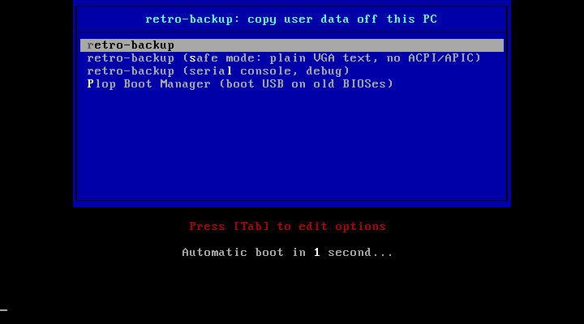
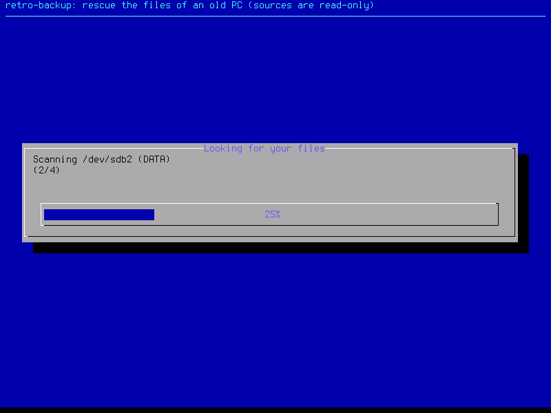
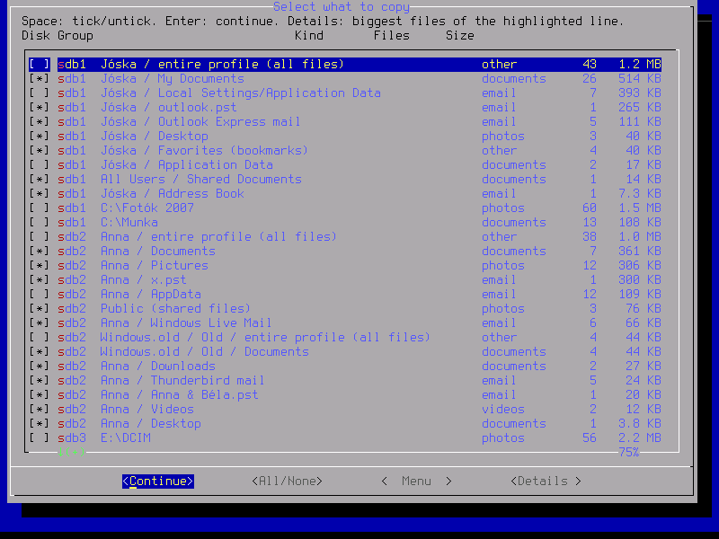
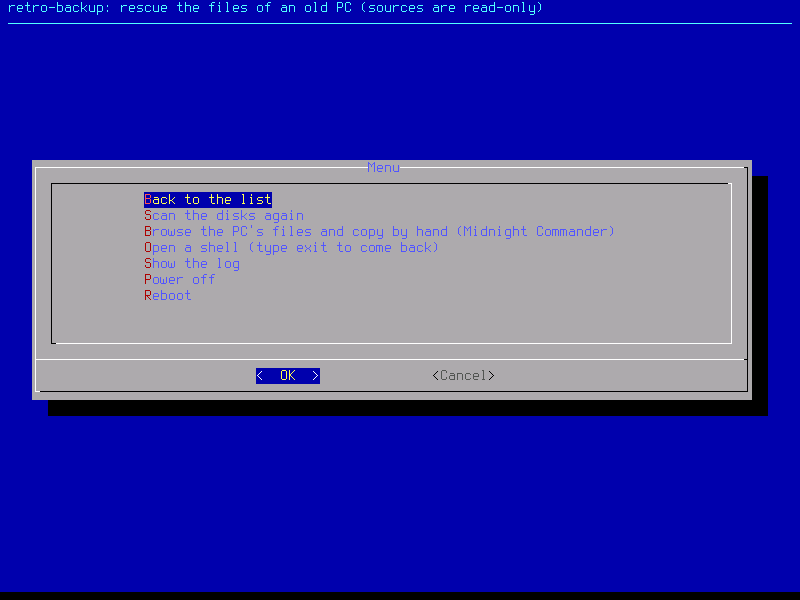
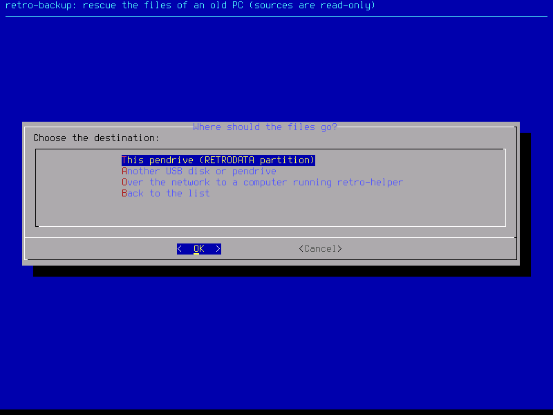
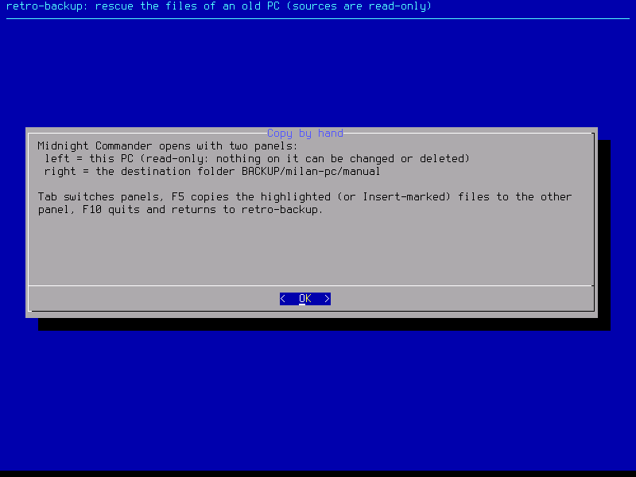
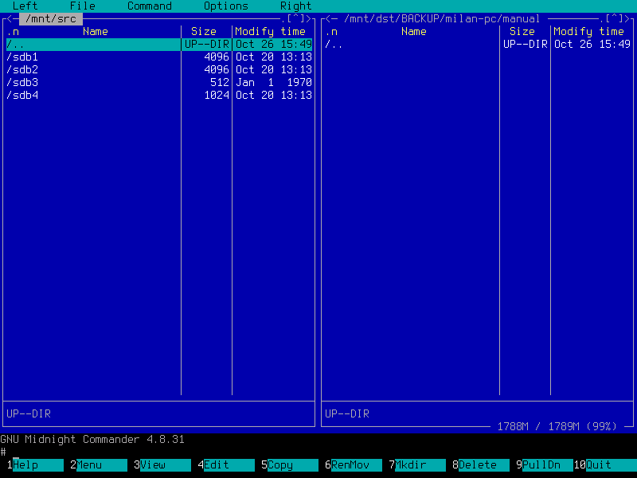
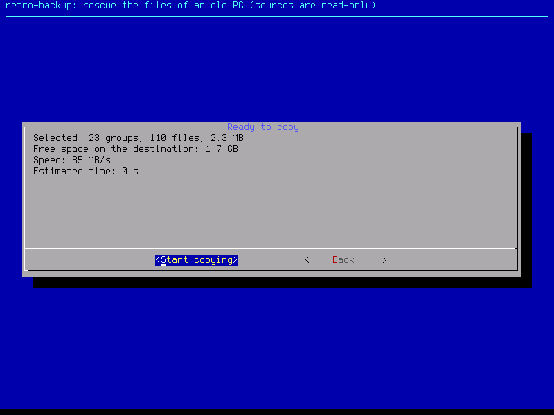
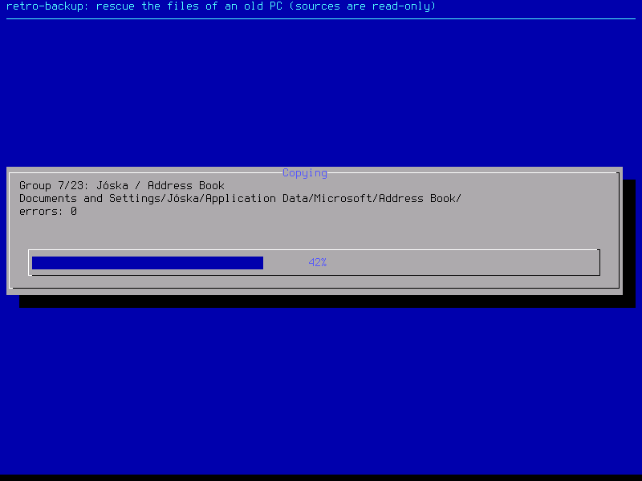
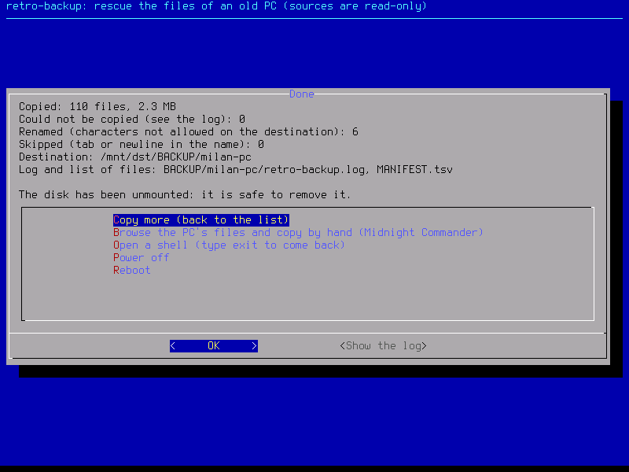

# retro-backup

A bootable pendrive (or PXE netboot) that starts an old PC from roughly 2000 to 2015, finds the
user's photos, videos, documents and email on its disks, shows them as a checklist, and copies
what you tick onto the pendrive or over the LAN to a modern machine. Everything on the old PC is
mounted read-only. See [PLAN.md](PLAN.md) for the design and [CONTRACTS.md](CONTRACTS.md) for the
interfaces between the parts.

Base system: Tiny Core Linux 16.2 (32-bit, i486 kernel 6.12.11 without PAE, so it also boots
Pentium M and Geode class CPUs). The whole system is about 30 MB and runs from RAM; 128 MB is
enough.

## Screenshots

Taken in QEMU on an emulated Pentium III with 256 MB (`make screenshot-tour`), against a test disk
with a Windows XP volume, a Windows 7 volume, a camera card and a Linux root.

| | |
|---|---|
|  **Boot menu.** Default entry, a safe entry with plain VGA text and no ACPI, a serial-console entry for debugging, and Plop for BIOSes that cannot boot USB. |  **Scanning.** Every volume is mounted read-only and searched for profiles, mail stores and media folders. |
|  **What was found.** Grouped by disk and user: documents, pictures, Outlook and Outlook Express mail, Thunderbird, Windows Live Mail, Maildir, plus "hot folders" like `C:\Fotók 2007` found by the sweep. Likely user data is pre-ticked. |  **Menu.** Rescan, shell, log, and the two-panel file manager for copying by hand. |
|  **Destination.** The pendrive itself, another USB disk, or a modern computer on the LAN running `retro-helper`. |  **Copy by hand.** What the two panels are and which keys do what. |
|  **Midnight Commander.** The PC's volumes on the left, read-only; a `manual` folder on the pendrive on the right. F5 copies, F10 returns. |  **Back in the list.** Ticks survive the detour. |
|  **Ready to copy.** Selection size against free space, a ten-second speed probe and the estimated time. |  **Copying.** Per group and per file, with an error count; md5 sums go into a manifest. |
|  **Done.** Totals, renames, failures, where the log is, and the options to copy more, open the file manager, or power off. | |

## Layout

| Directory | What |
|---|---|
| `build/` | Docker-based pipeline: fetch Tiny Core, remaster the initramfs, build the pendrive image and the ISO |
| `rootfs/opt/retro/` | The client: device discovery, scanner, dialog UI, copy stage (POSIX sh) |
| `helper/` | `retro-helper`: Go program for a modern Windows/macOS/Linux machine, PXE boot server and network receiver |
| `test/` | Fixture generators, scanner and copy tests, victim-disk generator for QEMU |
| `out/` | Build outputs (gitignored) |

## Build

Needs Docker (Docker Desktop on a Mac is fine, the build container runs as linux/amd64) and, for
the helper, Go 1.27. QEMU (`brew install qemu`) for the boot test.

```sh
make all          # fetch + remaster + image  ->  out/retro-backup.img, out/retro.iso
make helper       # copies the boot payload into helper/bootfiles and cross-compiles -> out/helper/
make test         # helper unit tests + client scanner/copy tests (Alpine container)
make victim       # out/victim.img: XP + Win7 NTFS, FAT32 camera card, ext3 Linux test disk
make test-qemu    # boots the image on an emulated Pentium III with 256 MB (QEMU_ARGS="--victim out/victim.img")
```

## Use

**Pendrive.** Write `out/retro-backup.img` to a stick of 8 GB or more with `build/flash.sh /dev/diskN`
(or Rufus in DD mode, or balenaEtcher). The stick has two partitions: `RETROBOOT` (boot files)
and `RETRODATA` (exFAT, where the copies land; old Windows versions do not show it, modern
machines do). The image is 1 GiB; on the first boot the client extends `RETRODATA` to the whole
stick while it is still empty, so a 32 GB stick gives about 31 GB of copy space. Files that macOS or
Windows drop onto a freshly mounted volume (`.fseventsd`, `System Volume Information`, ...) do not
count; if the partition holds anything else, the UI asks before extending it, since extending
erases the partition. If it ever stays small, pick the pendrive as destination and answer yes to
the "extend" question, or run `sh /opt/retro/05-stick.sh --force` from the tty2 shell. Boot the old PC from USB (boot menu is usually F12, F8, Esc or F11; if the BIOS
has no USB boot, burn `out/retro.iso` or the included Plop Boot Manager to a CD).

**LAN.** On a modern machine on the same wired network run `retro-helper --pxe --iface <nic>`,
set the old PC to boot from the network, and the same system loads over the LAN. Without `--pxe`
the helper only receives: boot the old PC from the stick and pick "network" as destination. See
[helper/README.md](helper/README.md) for the Windows, macOS and Linux specifics and the
direct-cable mode.

**On the old PC.** The screen shows the volumes found, then a checklist grouped by user and
folder (documents, pictures, email stores, and "hot folders" found by scanning the whole disk
for media and documents), then a destination choice, a space check and the copy with progress.
A manifest with md5 sums and a log are written next to the copies. Esc drops to a shell; tty2 is a
root shell, tty3 is Midnight Commander. "Browse the PC's files and copy by hand" in the
menu opens Midnight Commander (a Norton Commander style two-panel view) with the PC's disks on the
left, read-only, and a `manual` folder on the pendrive on the right; F5 copies, F10 returns. The console runs at 800x600 (VESA framebuffer, works on
any 2000s graphics card) with a Latin-2 font; the "safe" boot entry keeps plain 80x25 VGA text.

## Status

Works end to end in QEMU (`make test-e2e`): boots on an emulated Pentium III with 256 MB, mounts
NTFS, FAT32 and ext3 volumes read-only, finds the fixture profiles and email stores, copies to
the exFAT partition with verified md5 sums, and leaves the source disk byte-identical. Not yet
tested on real hardware. PXE boot has not been exercised against a real PXE ROM.
Known gaps: UEFI-only machines (no BIOS/CSM) are not supported yet; PXE option 43 layout is
unverified against real PXE ROMs; BitLocker/EFS are out of scope.
